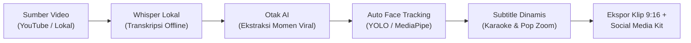

# 🚀 Marketing & Promotion Kit: LongShort AI
*Transformasi Video Panjang Menjadi Konten Pendek Viral dalam Hitungan Menit*

---

## 📌 Ringkasan Eksekutif & Identitas Produk

| Atribut | Detail |
| :--- | :--- |
| **Nama Produk** | **LongShort AI** *(ditenagai oleh arsitektur Auto Clipper v2)* |
| **Kategori** | Desktop & Cloud AI Video Repurposing Studio |
| **Platform** | Windows (x64), macOS (Apple Silicon M-Series & Intel x86_64), serta Web Cloud UI via Google Colab GPU |
| **Target Utama** | Podcaster, Content Creator, Streamer/Gamer, Agensi Konten, dan Digital Marketer |
| **Model Bisnis** | *Free & Open Ecosystem / Self-Hosted* (Bebas biaya langganan bulanan, Bring Your Own Key / Local AI) |

### Tagline Utama (Core Tagline)
> **"Ubah Video Berjam-jam Menjadi Klip Shorts Viral dalam 5 Menit. Tanpa Edit Manual, Tanpa Biaya Langganan."**

### Variasi Tagline Pendukung
1. *"Dari Podcast 2 Jam Jadi 5 Klip Siap Tayang Sambil Menikmati Kopi."*
2. *"Studio Repurposing Konten Otomatis: Deteksi Wajah Cerdas, Subtitle Pop Viral, dan Caption Lengkap Sekali Klik."*
3. *"Berhenti Scrubbing Timeline: Biarkan AI Menemukan Momen Emas Video Anda."*

---

## 💡 Masalah Nyata & Solusi yang Ditawarkan

### Masalah Kreator Konten Saat Ini (The Pain Points)
- **Waktu Terbuang Sia-Sia**: Menonton ulang video webinar atau podcast berdurasi 1-2 jam hanya untuk mencari potongan menarik 45 detik memakan waktu hingga berjam-jam.
- **Proses Editing Repetitif**: Mengubah orientasi video lanskap (16:9) ke vertikal (9:16), menggeser posisi kamera agar wajah tidak terpotong, serta mengetik subtitle satu per satu sangat membosankan.
- **Biaya Langganan SaaS yang Mahal**: Layanan pemotong video AI berbasis web (SaaS) umumnya mematok biaya $19 s/d $49 per bulan dengan batasan kuota menit yang sangat ketat.
- **Isu Privasi Data**: Banyak kreator dan perusahaan enggan mengunggah rekaman video mentah yang belum rilis ke server cloud pihak ketiga.

### Solusi dari LongShort AI
LongShort AI mengintegrasikan seluruh alur kerja video repurposing ke dalam satu aplikasi desktop yang intuitif dan bekerja secara lokal:
1. **Otomatisasi Penuh**: Mengunduh video (YouTube atau file lokal), mentranskripsikan suara menjadi teks, menganalisis bagian paling menarik menggunakan LLM, memotong video secara presisi, dan menempelkan subtitle animasi.
2. **Kamera Pintar Pelacak Wajah**: Otomatis mendeteksi wajah pembicara dan memposisikannya di tengah frame tanpa potongan kaku.
3. **Kemandirian Biaya (Zero Subscription)**: Menjalankan model pengenal suara Whisper secara offline di komputer pengguna atau di Google Colab GPU gratis.

---

## 🌟 8 Nilai Jual Utama (Unique Selling Propositions - USP)



### 1. 100% Bebas Biaya Langganan Bulanan (No Subscription Lock-in)
Tidak ada sistem kredit menit yang cepat habis atau tagihan bulanan. Pengguna dapat menghubungkan kunci API mereka sendiri (OpenAI, Google Gemini, Groq, DeepSeek), menggunakan model AI lokal gratis melalui Ollama / LM Studio, atau bahkan menggunakan **Mode Prompt Manual** yang 100% gratis tanpa API key apa pun.

### 2. Transkripsi Suara Offline & Menjaga Privasi (Faster-Whisper)
Proses pengubahan suara menjadi teks dilakukan langsung oleh mesin `faster-whisper` di perangkat pengguna. Dilengkapi fitur **Silero VAD (Voice Activity Detection)** yang otomatis memangkas jeda hening dan mencegah teks berulang. Data video tidak bocor ke pihak luar.

### 3. Pelacakan Wajah AI Dinamis (Dynamic Face Tracking - ADR-012)
Didukung sistem multi-engine yang fleksibel:
- **YOLOv8-Face ONNX (Default)**: Cepat, stabil, dan seimbang untuk semua jenis konten.
- **MediaPipe BlazeFace**: Pelacakan paling halus dengan deteksi multi-tile untuk gerakan aktif.
- **Haar Cascade**: Opsi ultra-ringan untuk laptop berspesifikasi rendah.
- Dilengkapi algoritma **Exponential Moving Average (EMA)** agar pergerakan kamera mengikuti pembicara secara sinematik tanpa patah-patah.

### 4. Animasi Subtitle Viral Standar Kreator Top (ADR-009)
Bukan subtitle statis biasa. LongShort AI menghasilkan subtitle ASS yang disesuaikan untuk media sosial:
- **Kata per Kata (Single-Word Pop Zoom)**: Gaya khas video edukasi/bisnis viral dengan efek membal.
- **Karaoke Dinamis**: Menyorot kata yang sedang diucapkan secara *real-time* dengan teknologi *zero-overlap*.
- **Kustomisasi Penuh**: Pilihan font (Plus Jakarta Sans, Outfit, Montserrat, dll.), warna sorotan, bayangan teks, hingga watermark nama channel.

### 5. Fleksibilitas Layout: Mode Kanvas & Split-Screen Gaming (ADR-008)
- **Mode Kanvas 9:16**: Menampilkan video horizontal (16:9) secara utuh di tengah layar ponsel dengan latar belakang video blur artistik, warna solid, atau poster khusus, lengkap dengan opsi pembesaran (zoom 1.0x - 2.0x).
- **Mode Video Gaming**: Deteksi tata letak otomatis yang memotong layar menjadi dua bagian (kamera wajah streamer di atas, permainan seru di bawah).

### 6. Paket Konten Media Sosial Lengkap (AI Social Kit)
Setiap klip yang dihasilkan langsung dilengkapi:
- 3 Rekomendasi Judul Viral dengan penilaian potensi klik (*Hook Score*).
- Deskripsi & Caption siap salin untuk TikTok, Instagram Reels, dan YouTube Shorts.
- Kumpulan Hashtag tertarget dan relevan.
- Ide visual sampul (Thumbnail Hook) dan rekomendasi jam tayang terbaik.

### 7. Koreksi Kata Cerdas & Render Ulang Super Cepat
Jika terdapat istilah teknis atau nama orang yang salah eja:
- Buka daftar kata klip secara visual.
- Perbaiki kata per kata secara langsung atau klik satu tombol **Perbaiki Otomatis dengan AI**.
- Render ulang klip tersebut dalam hitungan detik tanpa perlu mengulang transkripsi dari awal.

### 8. Cloud GPU Mode via Google Colab (Gratis T4 GPU)
Bagi pengguna dengan laptop berspesifikasi minimal, LongShort AI menyediakan buku kerja Jupyter (*Notebook*) siap pakai untuk menjalankan backend di Google Colab GPU secara gratis dan mengontrolnya dari antarmuka Web Browser.

---

## 🎯 Target Pengguna & Skenario Penggunaan

| Persona | Kebutuhan Utama | Bagaimana LongShort AI Membantu |
| :--- | :--- | :--- |
| **Podcaster & Talkshow** | Mengubah rekaman obrolan 1-2 jam menjadi 5-10 teaser di TikTok & Reels. | Otomatis melacak wajah narasumber/host bergantian dan memberi subtitle karaoke tebal. |
| **YouTuber & Edukator** | Memperluas jangkauan penonton dari video landscape ke Shorts vertikal. | Menemukan kesimpulan atau poin penting pembelajaran dan menambahkan b-roll ilustrasi. |
| **Live Streamer & Gamer** | Menangkap momen lucu, reaksi heboh, atau gameplay clutch. | Mode Split-Screen Gaming otomatis memisahkan facecam di atas dan layar game di bawah. |
| **Agensi & Content Repurposer** | Memproduksi puluhan video vertikal untuk banyak klien setiap hari. | Memangkas waktu pengerjaan dari 4 jam menjadi 15 menit per proyek, meningkatkan margin keuntungan. |
| **Pengusaha & Pembicara Publik** | Memotong materi seminar/webinar menjadi konten personal branding. | Mode Kanvas estetik mempertahankan slide presentasi tetap terbaca jelas di layar HP. |

---

## ⚔️ Perbandingan: LongShort AI vs Platform SaaS Populer

| Fitur / Parameter | LongShort AI | SaaS Berlangganan (Opus / Vidyo) | Video Editor Konvensional |
| :--- | :---: | :---: | :---: |
| **Biaya Bulanan** | **Rp 0 / Gratis (Bebas Langganan)** | $19 - $49 per bulan | Berlangganan / Lisensi Beli |
| **Batasan Menit Video** | **Tanpa Batas (Unlimited)** | Terbatas (mis. 60-150 menit/bulan) | Tergantung kapasitas fisik |
| **Privasi Transkripsi** | **100% Offline di Komputer Sendiri** | Diunggah ke server cloud pihak ketiga | Manual di komputer |
| **Pilihan Otak AI** | **Fleksibel (OpenAI, Gemini, Ollama, Manual)** | Terkunci pada penyedia bawaan | Tidak ada AI terintegrasi |
| **Face Tracking Cerdas** | **Multi-Engine (YOLO / MediaPipe)** | Ada (terbatas di cloud) | Harus di-keyframe manual |
| **Mode Tanpa API Key** | **Tersedia (Mode Prompt Manual)** | Tidak ada | Tidak ada |
| **Edit Teks Subtitle Per-Klip** | **Sangat Cepat & Ada Bantuan AI** | Terbatas | Manual satu per satu |
| **Akselerasi Hardware** | **NVIDIA NVENC + Auto CPU Fallback** | Mengantre di server cloud | Sesuai software |

---

## 📢 Toolkit Materi Promosi (Copywriting Siap Pakai)

### 1. Landing Page / Website Showcase Copywriting

#### [HERO SECTION]
- **Badge**: ⚡ *Studio AI Repurposing Video Versi 2.0*
- **Headline**: **Ubah 1 Video YouTube Panjang Menjadi 10 Klip Shorts Viral Dalam 5 Menit**
- **Sub-headline**: Hemat puluhan jam waktu editing. LongShort AI secara cerdas mendeteksi momen emas, memotong video ke format vertikal 9:16 dengan pelacak wajah otomatis, dan menempelkan animasi subtitle pop kekinian. Tanpa biaya langganan bulanan.
- **CTA Utama**: [📥 Unduh Gratis untuk Windows & Mac]
- **CTA Sekunder**: [▶️ Tonton Video Demo 1 Menit]
- **Mikro-copy**: *100% Offline-first • Kompatibel dengan OpenAI, Gemini & Ollama • Ringan & Cepat*

#### [SOCIAL PROOF / STATS]
- ⏳ **90% Hemat Waktu**: Dari 3 jam editing manual menjadi 5 menit otomatis.
- 💸 **Hemat Jutaan Rupiah**: Tidak perlu lagi membayar biaya langganan SaaS luar negeri.
- 🎯 **100% Presisi**: Subtitle karaoke anti-tumpang tindih dengan waktu bicara.

#### [FEATURE CAROUSEL / HIGHLIGHTS]
- **Fitur 1: Deteksi Momen Emas Berbasis AI**
  *Bukan sekadar memotong sembarangan. Algoritma AI menganalisis transkrip percakapan untuk memilih bagian dengan hook terkuat dan nilai retensi tertinggi.*
- **Fitur 2: Kamera Pintar Mengikuti Pembicara**
  *Video landscape dipotong ke vertikal secara dinamis ditenagai YOLOv8 dan MediaPipe. Wajah Anda selalu berada tepat di tengah layar.*
- **Fitur 3: Animasi Subtitle Single-Word Pop & Karaoke**
  *Tingkatkan retensi penonton hingga 200% dengan animasi kata aktif bergradasi warna modern dan preset tipografi ala kreator kelas dunia.*
- **Fitur 4: Dilengkapi Paket Judul, Caption & Hashtag Siap Upload**
  *Bukan cuma video, Anda langsung mendapatkan 3 variasi judul viral, caption persuasif, dan hashtag relevan untuk langsung diposting.*

---

### 2. Naskah Video Singkat TikTok / Instagram Reels / YouTube Shorts (30 - 45 Detik)

*Format: Video demonstrasi cepat dengan tampilan aplikasi.*

| Detik | Visual (Layar) | Audio (Voiceover / Bicara Cepat) |
| :---: | :--- | :--- |
| **00:00 - 00:05** | *Kreator menatap timeline video editing yang penuh track bertingkat dengan wajah stres.* | "Masih ngedit manual video podcast 2 jam cuma buat bikin 3 video TikTok? Stop buang-buang waktu kamu!" |
| **00:05 - 00:12** | *Layar beralih menampilkan antarmuka modern LongShort AI. Pengguna menempelkan satu link YouTube.* | "Kenalin: LongShort AI. Cukup copy link YouTube video kamu, paste di sini, lalu klik 'Buat Klip Pendek'." |
| **00:12 - 00:22** | *Animasi proses: suara ditranskrip, lalu preview video klip langsung tampil vertikal dengan subtitle kata membal dan kamera mengikuti wajah pembicara.* | "Secara otomatis, AI-nya bakal dengerin suara, milih momen paling seru, motong ke format vertikal 9:16 yang ngikutin wajah kamu, plus nempelin subtitle pop ala Alex Hormozi!" |
| **00:22 - 00:30** | *Kursor mengklik tab 'Paket Judul & Caption' di mana judul viral dan hashtag sudah siap di-copy.* | "Bahkan judul viral, caption, sama hashtag-nya udah dibikinin sekalian. Tinggal copy-paste langsung upload!" |
| **00:30 - 00:40** | *Tampilan logo LongShort AI dan link download.* | "Dan yang paling keren: aplikasinya jalan di laptop kamu tanpa langganan bulanan ribet! Unduh sekarang juga lewat link di bio!" |

---

### 3. Konten Media Sosial: Thread Twitter / Postingan LinkedIn

#### Format LinkedIn (Fokus Produktivitas & Efisiensi Konten Bisnis):
```markdown
Membuat 1 video panjang itu melelahkan. Tapi mengubahnya menjadi 10 konten pendek seringkali jauh lebih menyiksa.

Sebagai konten kreator atau pengelola brand, kita sering terjebak dalam siklus:
1. Nonton ulang rekaman webinar/podcast 2 jam.
2. Catat menit-menit yang bagus.
3. Potong manual ke rasio vertikal 9:16.
4. Koreksi subtitle kata per kata.
5. Mikir judul dan caption untuk masing-masing klip.

Hasilnya? Waktu 3-4 jam habis hanya untuk memproduksi 2 klip video pendek.

Inilah alasan kami merancang LongShort AI: Studio otomatisasi repurposing video untuk kreator modern.

Apa yang bisa dilakukan LongShort AI dalam 5 menit?
✅ Mengunduh video langsung dari YouTube atau file lokal.
✅ Mentranskripsikan suara secara offline menggunakan Faster-Whisper (100% aman & menjaga privasi).
✅ Memilih momen terbaik dengan algoritma penilaian viralitas AI.
✅ Auto Face Tracking: Kamera otomatis mendeteksi dan mengikuti wajah pembicara secara halus.
✅ Merender animasi subtitle kata per kata (Single-word Pop & Karaoke) dengan tipografi premium.
✅ Menyiapkan paket media sosial: 3 opsi judul menarik, caption lengkap, dan kumpulan hashtag.

Dan bagian terbaiknya?
Bebas biaya langganan bulanan. Anda memegang kendali penuh di komputer Anda sendiri.

Sudah siap mengubah arsip video panjang Anda menjadi sumber traffic harian?
Tautan unduh dan panduan instalasi tersedia di kolom komentar pertama. 👇
```

#### Format X / Twitter Thread (Ringkas, Berisi, & Viral):
```markdown
1/7 Cara saya mengubah 1 video YouTube berdurasi 2 jam menjadi 5 video TikTok/Reels viral dalam 5 menit (tanpa bayar langganan software mahal): 🧵👇

2/7 Masalah tools klip online saat ini:
- Batasan menit bulanan yang sedikit.
- Biaya $20 - $50 tiap bulan.
- Data video harus diupload ke cloud orang lain.

Solusinya: Pakai LongShort AI yang berjalan langsung di laptop/PC kita.

3/7 Fitur 1: Deteksi Wajah Otomatis (Face Tracking)
Waktu video landscape 16:9 diubah jadi vertikal 9:16, kamera otomatis mengikuti posisi wajah pembicara pakai YOLOv8/MediaPipe. Gak ada lagi muka kepotong di pojok layar.

4/7 Fitur 2: Subtitle Pop & Karaoke Kekinian
Subtitle-nya bukan teks kaku. Ada efek membal (Single-Word Pop) atau sorotan kata aktif (Karaoke) anti-overlap yang bikin penonton betah nonton sampai detik terakhir.

5/7 Fitur 3: Social Kit Siap Pakai
Bukan cuma potong video. Sekali klik, AI langsung ngasih:
- 3 Rekomendasi Judul Viral
- Deskripsi / Caption siap posting
- Kumpulan Hashtag relevan
- Rekomendasi jam tayang terbaik

6/7 Gak punya API Key?
Tenang, ada "Mode Prompt Manual". Aplikasi bakal nyiapin transkrip dan prompt rapi yang tinggal kamu paste ke ChatGPT/Claude gratisan di browser, lalu tempel hasilnya balik ke aplikasi.

7/7 Mau coba sekarang?
Aplikasi ini mendukung Windows & macOS. Cek link unduhnya di sini: [Link]
Retweet tweet pertama jika tips ini bermanfaat untuk konten kamu! 🔁
```

---

## ❓ Mengatasi Keraguan Calon Pengguna (Objection Handling FAQ)

### T: Apakah komputer saya harus memiliki spesifikasi gaming/render yang tinggi?
**J:** Tidak harus. LongShort AI dirancang sangat fleksibel:
- Model transkripsi default (*Whisper Small*) sangat ringan dan dapat berjalan lancar di prosesor standar Intel Core i5 / AMD Ryzen 5 tanpa GPU khusus.
- Untuk pelacakan wajah, tersedia pilihan engine *Haar Cascade* yang sangat hemat daya.
- Jika laptop Anda benar-benar berspesifikasi rendah, Anda bisa menjalankan mesin komputasi beratnya di **Google Colab GPU T4 secara gratis** dan cukup membuka tampilannya lewat web browser!

### T: Apakah aplikasi ini benar-benar gratis tanpa biaya tersembunyi?
**J:** Ya, aplikasi LongShort AI 100% gratis digunakan. Seluruh mesin pemrosesan video dan pengenal suara Whisper berjalan langsung di perangkat Anda tanpa memotong pulsa atau saldo apa pun. Untuk otak analisis AI, Anda bebas menggunakan kuota gratis Google Gemini, OpenAI dengan sistem bayar sesuai pemakaian (hanya beberapa rupiah per video), model lokal Ollama gratis, atau menggunakan Mode Prompt Manual tanpa biaya API sama sekali.

### T: Bagaimana jika saya tidak paham cara membuat API Key?
**J:** Anda tetap bisa menggunakan LongShort AI dengan memanfaatkan **Mode Prompt Manual**. Aplikasi akan mentranskripsikan suara video Anda secara offline dan membuatkan teks perintah (prompt) khusus. Anda tinggal menyalin teks tersebut ke ChatGPT atau Claude gratis di web browser, lalu menyalin kembali balasannya ke aplikasi untuk langsung dipotong menjadi klip jadi!

### T: Bagaimana jika ada kata dalam subtitle yang salah eja?
**J:** Anda tidak perlu mengulang render dari awal. Cukup klik ikon pensil pada klip yang bersangkutan, Anda bisa mengubah kata yang salah secara manual atau menekan tombol **Perbaiki Otomatis dengan AI**, lalu tekan *Simpan & Render Ulang Klip*. Dalam beberapa detik video baru Anda selesai dengan subtitle yang sudah rapi.

---

## 🏁 Rencana Peluncuran Promosi (Go-To-Market Checklist)

- [ ] **Persiapan Aset Visual**: Tangkap layar (*screenshot*) beresolusi tinggi untuk Dark Mode Studio, animasi subtitle pop, dan panel Social Kit.
- [ ] **Video Teaser 30 Detik**: Buat rekaman layar sebelum vs sesudah (video podcast landscape yang dipotong menjadi vertikal dengan kamera mengikuti pembicara).
- [ ] **Distribusi Komunitas**:
  - Grup Facebook / Discord Kreator Konten, Podcaster Indonesia, dan Streamer Gaming.
  - Forum Reddit (`r/videocreators`, `r/contentcreation`, `r/podcasting`).
  - Thread informatif di LinkedIn & Twitter/X.
- [ ] **Materi Dokumentasi**: Sertakan tautan panduan singkat di Pusat Bantuan aplikasi (`HelpPage`) untuk mempermudah pengguna baru saat pertama kali membuka aplikasi.
